## W11｜Figma 網站設計優化與作業二檢討

### 一、今天要學什麼？

前幾週我們已經學習如何使用 Figma 製作網站，包含文字、形狀、按鈕、Prototype、外部連結及滾動效果。

上週已經進行練習作業二的成果繳交，本週將繼續進行作業二的檢討與修改。

完成一個網站，不只是把五個頁面做出來。

還需要思考：

1. 網站的內容是否完整？
2. 網站的畫面是否容易閱讀？
3. 五個頁面的設計風格是否一致？
4. 使用者是否知道如何操作網站？
5. 按鈕與頁面連結是否正常？
6. 作業繳交的檔案是否完整？

今天不會新增其他作業，而是針對目前已經製作的網站進行檢討與優化。

### 二、網站設計常見問題

#### 1. 文字大小與版面混亂

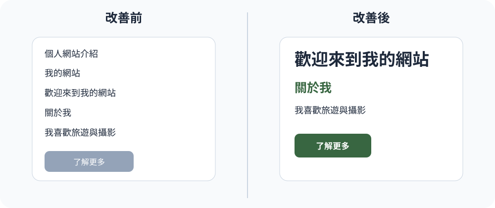

改善前

文字缺乏層級、排列不一致

改善後

標題明顯、文字排列整齊

如果網站中的標題、內文及按鈕文字都使用相同大小，訪客可能不知道應該先閱讀哪個部分。

可以透過調整文字大小、粗細與位置，讓重要的資訊更加明顯。

#### 2. 使用太多顏色

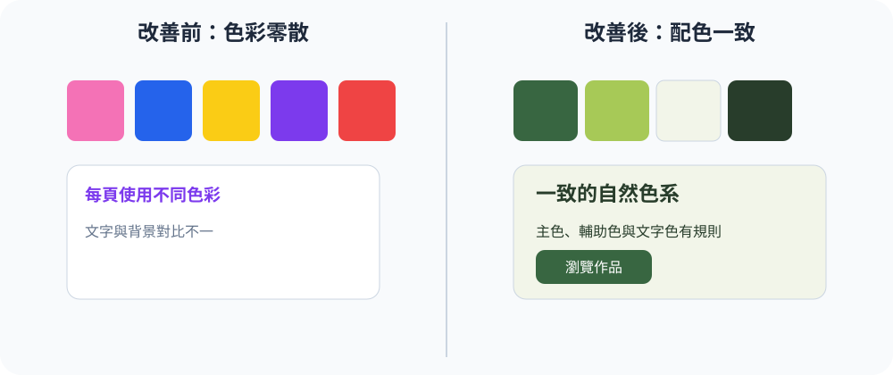

改善前

顏色過多、缺乏統一風格

改善後

配色一致、具有整體風格

網站不一定要使用很多顏色才會好看。

如果每個頁面使用完全不同的配色，或文字與背景顏色太接近，可能會造成閱讀困難。

建議先決定網站的整體風格，再選擇適合的配色。

#### 3. 畫面缺乏留白

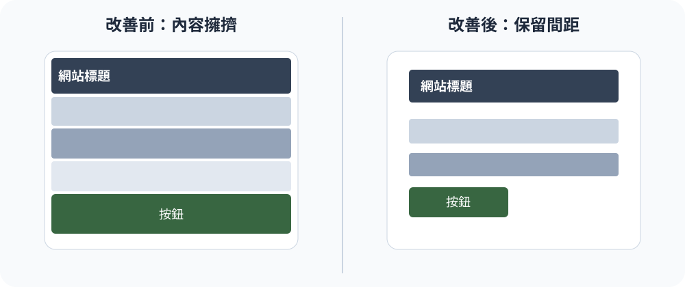

改善前

所有內容擠在一起

改善後

物件之間保留適當空間

有時候會覺得網站畫面太空，所以想加入更多文字、圖片或裝飾。

但是：

> 不是畫面中的每個地方都需要放東西。

適當的留白可以讓訪客更容易找到重要資訊。

#### 4. 網站互動不完整

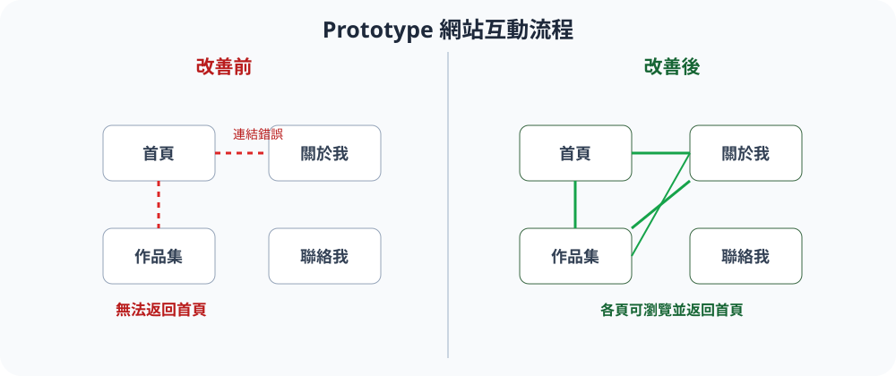

改善前：部分頁面無法前往或返回

改善後：每個頁面都能順利瀏覽

建立五個 Frame，不代表網站已經完成。

還需要確認：

- 按鈕是否可以點擊？
- 是否會跳轉到正確的頁面？
- 是否可以瀏覽所有頁面？
- 進入其他頁面後，是否可以返回首頁？

記得使用 Prototype 的播放功能，實際操作自己的網站。

### 三、網站視覺設計的四個基本觀念

#### 1. 對齊（Alignment）

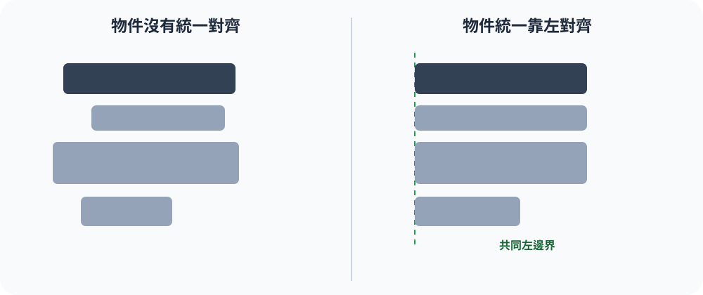

物件沒有統一對齊

物件統一靠左對齊

讓標題、內文、圖片與按鈕按照一定的規則排列，畫面會看起來更加整齊。

在 Figma 中，可以同時選取多個物件，使用對齊功能調整位置。

[Aligning and Distributing Elements in Figma](https://images.openai.com/static-rsc-4/v-4_PUhinN_haPjEgO24JshmVgIixrLXgMJ7T_gKt989Sit6vVUQCmMAAcE2tQlNnPEFR9nAgqX1JLdLCN3i6tT7vX7QlQuwAWHfHvW75tWrN6zN_z4cVHT81RMccmpydOXhq_HTx1oGyRFjNPDQYycXr2NG0OUu5KEOAQDYbro?purpose=inline)

[thecodeaccelerator.com](https://thecodeaccelerator.com/blog/aligning-and-distributing-elements-in-figma)

常見的對齊方式：

| 英文名稱 | 功能 |
| --- | --- |
| Align left | 靠左對齊 |
| Align horizontal centers | 水平置中對齊 |
| Align right | 靠右對齊 |
| Align top | 靠上對齊 |
| Align vertical centers | 垂直置中對齊 |
| Align bottom | 靠下對齊 |

不一定所有物件都要靠左或置中，重點是排列方式要有一致的規則。

#### 2. 留白（White Space）

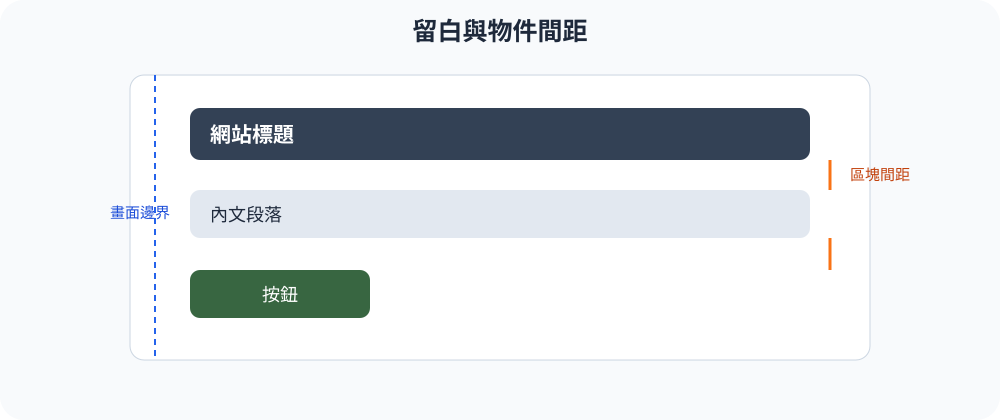

留白是指文字、圖片及其他設計物件之間所保留的空間，不一定要是白色。

網站中可以保留空間的位置包含：

- 網站畫面與邊界之間。
- 標題與內文之間。
- 不同段落之間。
- 圖片與圖片之間。
- 按鈕與其他物件之間。

留白可以幫助訪客區分不同的資訊，也能讓網站畫面更加舒服。

#### 3. 配色一致性（Color Consistency）

可以先為自己的網站選擇一組配色，包含主色、輔助色、背景色及文字色。

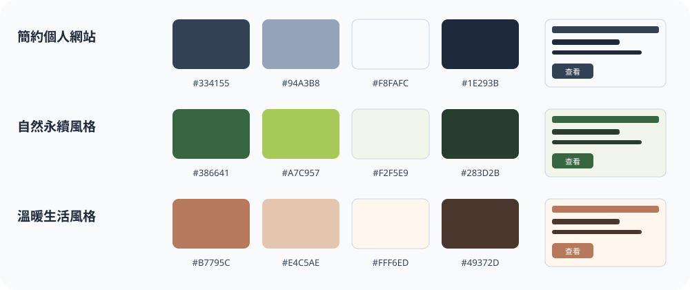

範例一｜簡約個人網站

| 類型 | HEX 色碼 |
| --- | --- |
| 主色 | `#334155` |
| 輔助色 | `#94A3B8` |
| 背景色 | `#F8FAFC` |
| 文字色 | `#1E293B` |

[Portfolio by Romain Abidonn on Dribbble](https://images.openai.com/static-rsc-4/1d-ivQfSCoFXb2F1MH2F2bMIe65acijp-9my44aWjsRBPfojRb-edyd8pUOVyAjxpeVPnNk7Er7RlwwNGiTvZUD7HESoORFA6xkQSxEQpQvazhlHU3giCxrrz0Sp0MXuCwKL7QhjSqu1tR1tWwRtHiCdghnNcm4KOuwWMFRSFus?purpose=inline)

[dribbble.com](https://dribbble.com/shots/14351226-Portfolio)

範例二｜自然永續風格

| 類型 | HEX 色碼 |
| --- | --- |
| 主色 | `#386641` |
| 輔助色 | `#A7C957` |
| 背景色 | `#F2F5E9` |
| 文字色 | `#283D2B` |

[Eco Website designs, themes, templates and downloadable graphic elements on Dribbble](https://images.openai.com/static-rsc-4/IaV5BuzXi5xaeZgMbIBkYoQyM-cxHbY7MN35fAR4ObGynytGOIsdMWLuCRWmOsLkKX_rgsg7cFmI5RlJJ0to1WMa-PiuNogFydnzoa57iIsyYzm3o5eOPt4k8VJsk8UobQ2aWb7TlWPSaTQfdUCyiGwAGm1kKaOGWKHLP3bm14o?purpose=inline)

[dribbble.com](https://dribbble.com/tags/eco-website)

範例三｜溫暖生活風格

| 類型 | HEX 色碼 |
| --- | --- |
| 主色 | `#B7795C` |
| 輔助色 | `#E4C5AE` |
| 背景色 | `#FFF6ED` |
| 文字色 | `#49372D` |

[Best Teacher Website Examples of 2025](https://images.openai.com/static-rsc-4/f5JS---3JaIpzZHlp0yd3DV03nUpSfOXOwlSzwnF_GvitlSDB4gAIUt5oFYQ1GuTFiWzphqVWhfXRVllIa2mIx9u3jTcBwp49t_avXcHjvsnQBeh9_Udj3sGZLlhmeOGjAB6KdwHVdC9K9hm3M_RJ2rCBfUgCORZkGI87ctkVSg?purpose=inline)

[wixfresh.com](https://www.wixfresh.com/post/teacher-websites)

以上配色只是範例，可以依照自己的網站主題選擇不同的顏色。

#### 什麼是 HEX 色碼？

HEX 色碼是一種表示顏色的方式。

例如：

| HEX 色碼 | 顏色 |
| --- | --- |
| `#FFFFFF` | 白色 |
| `#000000` | 黑色 |
| `#386641` | 深綠色 |
| `#FFF6ED` | 米白色 |

在 Figma 中，可以選取物件，找到右側面板的 `Fill`，輸入對應的 HEX 色碼。

[Figma 個人作品集網站設計操作參考](https://images.openai.com/static-rsc-4/jnG3Y2y5g0ZrvsXenR88JZQAu8dIyO-g5ah6-l0LmDqS5Zd_EmdalRInaVDGDn5qmzgL2mtGqBb0urbkno0mREN1og7Axmy0wmj-NJodqVLqLi6zs8yiuJE7cnaest6-Zcz04sDVtqIfxU58fNBBW-ZP7bMjHx2bfq8gzGlLfzc?purpose=inline)

[bringyourownlaptop.com](https://bringyourownlaptop.com/blog/create-design-portfolio-website-figma)

這樣就不需要每次重新挑選顏色，也比較容易讓五個頁面的配色維持一致。

#### 4. 視覺層級（Visual Hierarchy）

視覺層級是指透過文字大小、顏色、粗細與位置，讓使用者知道哪些資訊比較重要。

例如：

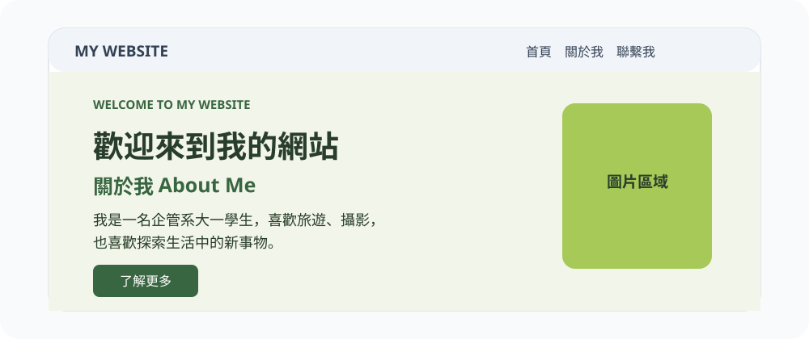

在這個範例中，可以看到網站主標題最明顯，接著是頁面標題、內文及按鈕。

不同類型的文字，可以參考以下大小：

| 文字類型 | 建議大小 |
| --- | --- |
| 網站主標題 | 40～48 px |
| 頁面標題 | 28～36 px |
| 小標題 | 20～24 px |
| 一般內文 | 16～18 px |
| 補充說明 | 12～14 px |

以上大小只是設計參考，可以依照自己的 Frame 尺寸調整。

重要觀念

> 不是所有資訊都要一樣大，而是越重要的資訊，應該越容易被看見。

### 四、使用 ChatGPT 協助改善網站

還記得 W3 學過的 Prompt 撰寫技巧，以及 W4 學過的圖片理解功能嗎？

除了使用 ChatGPT 協助規劃網站內容，也可以將目前製作的 Figma 網站截圖提供給 ChatGPT，請 AI 協助檢查網站設計。

#### 範例一｜檢查網站設計

將自己的網站畫面截圖，上傳至 ChatGPT。

輸入：

> 我是企管系大一學生，正在使用 Figma 製作個人網站。這是目前的網站設計截圖，請從配色、文字大小、版面配置、物件對齊及留白五個面向進行分析，並提供具體的修改建議。請使用初學者容易理解的方式說明。

#### 範例二｜改善網站配色

如果不知道如何選擇網站顏色，可以輸入：

> 請根據我提供的網站截圖，推薦三組適合此網站風格的配色方案，每組包含主色、輔助色、背景色及文字色，並提供 HEX 色碼，最後使用表格整理。

#### 範例三｜檢查網站文字內容

> 請根據我的網站截圖，檢查目前的文字內容是否清楚、是否有需要補充的資訊，並提供修改建議，但不要自行編造我的個人資料。

#### 範例四｜改善網站排版

> 我是第一次使用 Figma 製作網站，請根據我提供的網站截圖，告訴我哪些物件的位置可以調整，以及標題、內文、圖片與按鈕應該如何排列，才能讓畫面更加整齊。請不要使用太複雜的設計方式。

#### 重要觀念

ChatGPT 可以提供設計建議，但不一定要接受所有建議。

網站的風格與內容，仍然可以依照自己的喜好決定。

另外，如果使用 ChatGPT 協助修改網站，也可以將下指令的過程截圖，補充至作業二的 AI 工具使用紀錄。

### 五、認識使用者體驗（User Experience，UX）

網站設計除了外觀之外，也需要考慮使用者實際操作時的感受。

我們可以先認識兩個名詞：

| 名稱 | 中文 | 主要關注的內容 |
| --- | --- | --- |
| UI（User Interface） | 使用者介面 | 網站的外觀、文字、顏色、按鈕與排版 |
| UX（User Experience） | 使用者體驗 | 使用網站時是否方便、容易理解及操作 |

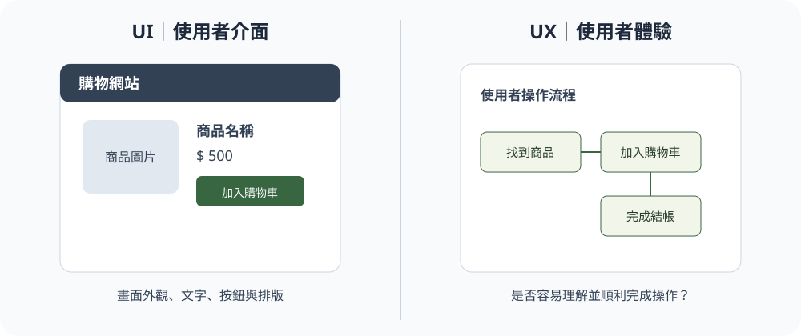

UI 使用者介面

畫面看起來如何？按鈕與文字是否清楚？

UX 使用者體驗

使用者是否知道下一步該做什麼？能否順利完成操作？

例如一個購物網站，畫面設計得很好看，但是使用者找不到購物車或結帳按鈕。

即使網站的外觀很好，使用者的操作體驗仍然可能不好。

因此，設計自己的網站時，也可以從訪客的角度思考：

| 檢查項目 | 思考問題 |
| --- | --- |
| 首頁 | 訪客能不能快速理解網站的主題？ |
| 導覽 | 訪客知不知道如何前往其他頁面？ |
| 互動 | 按鈕是否可以正常點擊？ |
| 頁面 | 是否能夠順利瀏覽五個頁面？ |
| 閱讀 | 文字是否清楚、容易閱讀？ |
| 設計 | 整體配色與排版是否一致？ |

> 網站不只是自己覺得好看，更重要的是使用者是否知道如何操作。

### 六、練習作業二要求回顧

#### 練習作業二：5%

使用 Figma 軟體製作，以下主題二選一。

1. 個人網站

   - 至少包含首頁（Homepage）。
   - 自訂主題分頁 3 頁。
   - 聯繫我（Contact Me）。
   - 共至少 5 個頁面。
   - 須包含內容文字、按鈕與頁面連結功能。

2. 教導大一生永續學習教材

   - 中文或英文皆可。
   - 至少 5 個頁面。
   - 須包含內容文字、按鈕與頁面連結功能。
   - 選擇此主題將加分。

AI 工具使用要求

- 須運用 ChatGPT 或其他 AI 工具輔助網站製作至少 1 個指令。
- 截圖 AI 下指令的過程。
- 另附一個 Word 檔，貼上下指令（含提示語）過程的截圖。

### 七、作業二評分標準

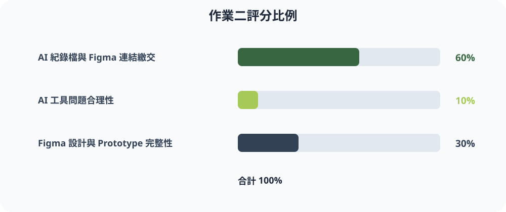

AI 工具使用紀錄檔與 Figma 連結繳交

60%

AI 工具問題合理性

10%

Figma 排版設計與 Prototype 互動完整性

30%

| 評分項目 | 評分比例 |
| --- | ---: |
| AI 工具使用紀錄檔與 Figma 連結繳交 | 60% |
| AI 工具問題合理（例如網站配色建議、排版建議、內容發想等） | 10% |
| Figma 排版設計與 Prototype 互動完整 | 30% |
| 合計 | 100% |

### 八、作業繳交常見問題

#### 1. 只有建立五個 Frame，沒有完成內容

五個 Frame 應該代表五個具有實際內容的網站頁面，而不是只有頁面名稱或空白畫面。

#### 2. 有製作按鈕，但沒有設定 Prototype

按鈕的外觀與互動功能是不同的設定。

請確認按鈕已經設定正確的 Trigger、Action 與 Destination。

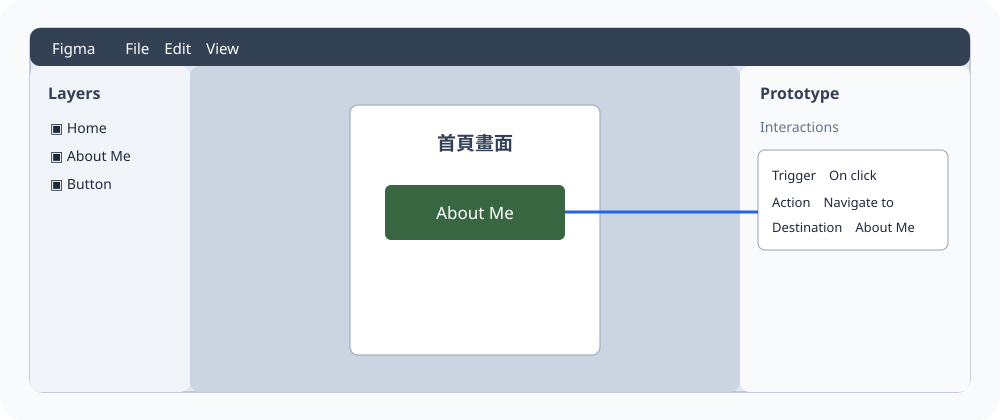

[Conecta tu prototipo – Figma Learn - Centro de ayuda](https://images.openai.com/static-rsc-4/mZ3b7Z3PObDpNCQ25MJ2rk51ggFQmd12zPpFKMYZIt3dHYCWL0g5GeoN9lhbfcpDHDQGb-WRogXDpXM0lszRegWGlUz_2mXzMw_m0QVvJaM9fg-NimFqEKGC38MSbvQJzcY5DIqjqEIHx7sA95RQdp-iUMzGKIcKmMJBTHP1Cm0?purpose=inline)

[help.figma.com](https://help.figma.com/hc/es-419/articles/360040315773-Conecta-tu-prototipo)

例如：

`On click → Navigate to → About Me`

#### 3. AI 使用紀錄只有回答，沒有下指令的過程

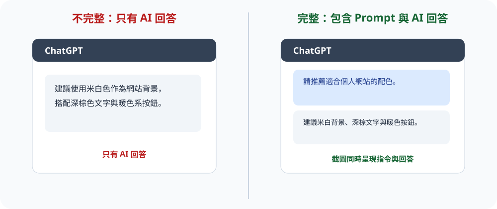

ChatGPT

建議使用米白色作為網站背景，搭配深棕色文字與暖色系按鈕。

不完整

只有 AI 回答

ChatGPT

請推薦適合個人網站的配色。

建議使用米白色作為網站背景，搭配深棕色文字與暖色系按鈕。

完整範例

包含 Prompt 與 AI 回答

作業要求的是 AI 下指令的過程，因此至少需要確認自己輸入的 Prompt 有出現在截圖中。

#### 4. Figma 分享連結無法開啟

完成作品後，請確認 Figma 的分享權限。

[Guide to sharing and permissions – Figma Learn - Help Center](https://images.openai.com/static-rsc-4/627ddP2gWK-5F_twrZEiqJLROjt7M6oIoaSWzgQ44mWNdoqP0wKjBtCpmH1QDPJrYreGvIBvLj8RVSaZ03j6MxWf3Si168-HZkr1J0O_IblhCnegrnblrgV_4iFG8dSk7mm1A6dvXV_Rqi84mrVtObV6xexpjs3acaWBYA7mHds?purpose=inline)

[help.figma.com](https://help.figma.com/hc/en-us/articles/1500007609322-Guide-to-sharing-and-permissions)

1. 點選右上角的 `Share`。
2. 確認分享對象。
3. 若工作空間允許，選擇 `Anyone with the link`。
4. 權限選擇 `Can view`。
5. 複製分享連結。

也可以將連結貼到瀏覽器的無痕視窗，確認其他人是否可以正常開啟，或確認評分者已取得檢視權限。

### 九、作業二最終檢核清單

完成作業或修改作品後，可以依照以下內容逐一確認。

## 作業二成果檢核

### 網站基本內容

- [ ] 至少完成五個網站畫面
- [ ] 每個頁面都有符合主題的文字內容
- [ ] 包含按鈕及頁面連結功能
- [ ] 符合所選擇的作業主題

### 網站視覺設計

- [ ] 五個頁面的配色及風格一致
- [ ] 標題與內文具有明顯區別
- [ ] 文字與物件排列整齊
- [ ] 畫面具有適當的留白

### Prototype 互動功能

- [ ] 可以從首頁前往其他頁面
- [ ] 按鈕跳轉至正確的頁面
- [ ] 可以透過導覽或按鈕返回首頁
- [ ] 已實際使用 Prototype 預覽測試

### 作業繳交

- [ ] 至少使用一次 AI 工具輔助網站製作
- [ ] 已將 AI 下指令過程截圖整理至 Word
- [ ] Figma 分享連結可以正常開啟
- [ ] 確認繳交的連結及檔案正確

### 十、作業二成果修改時間

本週剩餘時間請繼續完成練習作業二，並根據今天介紹的內容，檢查自己的網站是否有需要改善的地方。

如果已經完成作業，也可以針對網站的配色、文字大小、排版及 Prototype 互動功能進行優化。

不需要為了增加網站的複雜程度，而刻意加入太多功能。

一個好的網站，應該具有清楚的內容、一致的設計風格，以及容易操作的互動功能。
